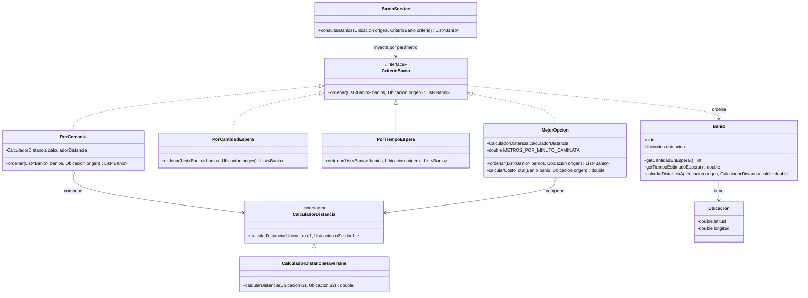
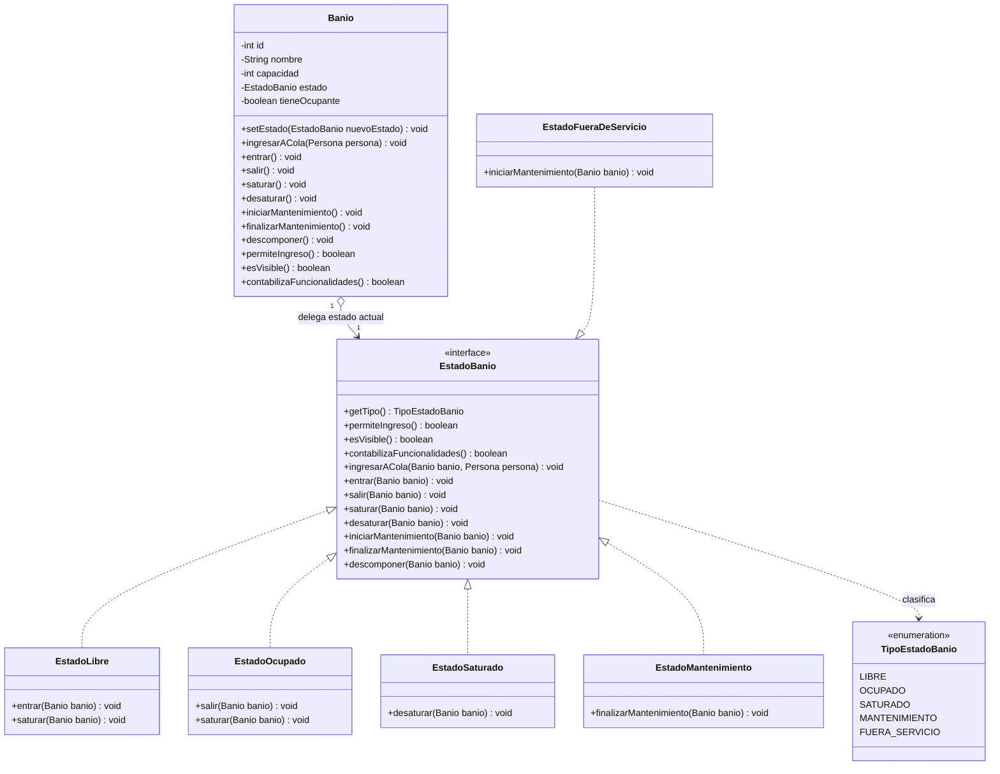
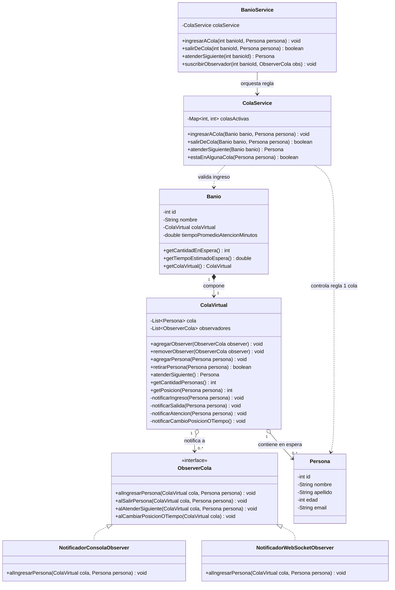
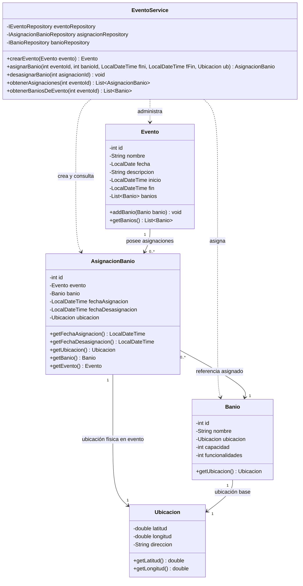

# Diagrama de Clases UML — Arquitectura de Dominio y Patrones

Para garantizar máxima legibilidad y evitar tipografía reducida por densidad de nodos, la arquitectura estática se encuentra modularizada en **4 diagramas temáticos de responsabilidad única**:

1. [**Patrón Strategy: Búsqueda y Distancia**](diagrama-strategy.md)
2. [**Patrón State: Estados y Ciclo Operativo del Baño**](diagrama-state.md)
3. [**Patrón Observer: Colas Virtuales y Notificaciones**](diagrama-observer-colas.md)
4. [**Dominio: Asignación Temporal de Infraestructura a Eventos**](diagrama-asignacion-evento.md)

---

## 1. Patrón Strategy: Criterios de Ordenamiento y Cálculo de Distancia

Desacopla los algoritmos de selección y ordenamiento de baños respecto del servicio y del dominio.

---

## 2. Patrón State: Ciclo Operativo y Estados del Baño

Reemplaza condicionales de estado por polimorfismo puro. Modela el meta-estado de saturación y las contingencias según la documentación técnica.

---

## 3. Patrón Observer: Colas Virtuales y Notificaciones

Modela la reactividad de las colas virtuales ante altas, bajas y avances, desacoplado de interfaces gráficas o frameworks.

---

## 4. Dominio: Asignación Temporal de Infraestructura a Eventos

Modela la entidad intermedia `AsignacionBanio` que otorga vigencia temporal y ubicación espacial a los baños dentro de un evento masivo.

