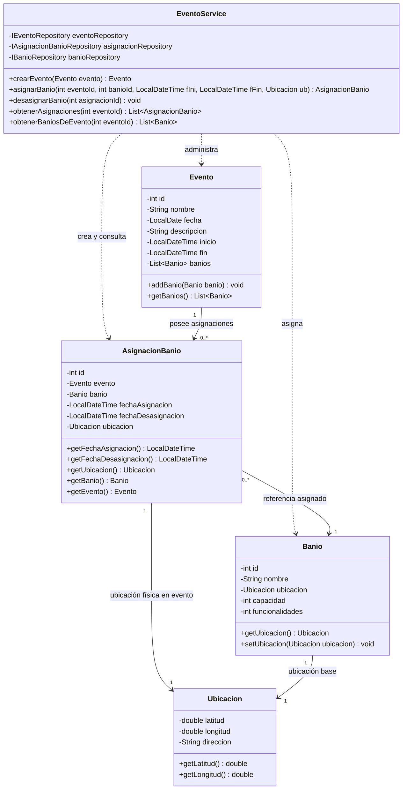

# Diagrama de Clases UML — Asignación Temporal de Infraestructura a Eventos

Este diagrama modela la relación entre los eventos masivos y la infraestructura sanitaria disponible, desacoplando los baños del ciclo de vida del evento mediante una entidad intermedia reificada (`AsignacionBanio`).

## Diagrama Mermaid

## Puntos Clave

1. **Desacoplamiento Temporal**: Un baño químico es un activo físico reusable. No pertenece permanentemente a un evento ni desaparece cuando el evento finaliza.
2. **Entidad Intermedia Reificada (`AsignacionBanio`)**: Resuelve la relación muchos a muchos con atributos propios de la asociación: `fechaAsignacion`, `fechaDesasignacion` y `ubicacion` específica en el predio del evento.
3. **Servicio Orquestador (`EventoService`)**: Encapsula las transacciones de asignación y desasignación interactuando con los repositorios correspondientes.
