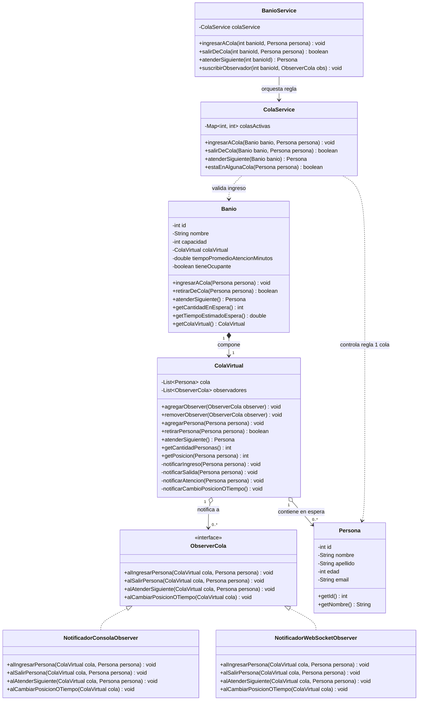

# Diagrama de Clases UML — Patrón Observer y Colas Virtuales

Este diagrama modela la gestión reactiva de las colas virtuales asociadas a cada baño mediante el patrón `Observer`, junto con la regla de negocio que prohíbe que una persona pertenezca a más de una cola simultáneamente.

## Diagrama Mermaid

## Puntos Clave

1. **Sujeto Observable Puro (`ColaVirtual`)**: Notifica cambios de estado (altas, bajas, desplazamientos de posición) a la interfaz `ObserverCola` sin conocer detalles de presentación.
2. **Extensibilidad de Notificaciones**: Permite desacoplar salidas a consola (`NotificadorConsolaObserver`) de notificaciones reactivas para WebSocket o Server-Sent Events (`NotificadorWebSocketObserver`).
3. **Control de Regla de Negocio (`ColaService`)**: La restricción "una persona, como máximo una cola" no es responsabilidad de la cola individual sino del orquestador de colas en la capa de aplicación.
