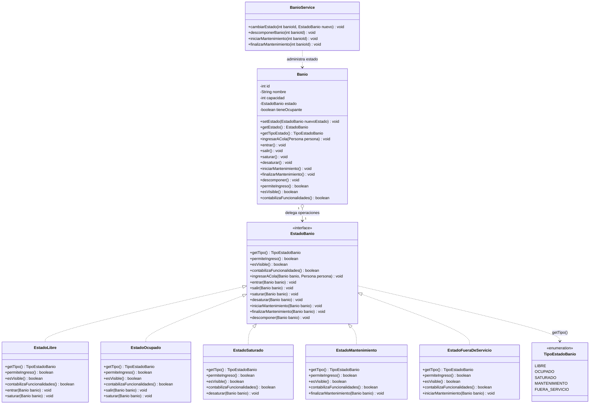

# Diagrama de Clases UML — Patrón State (Estados y Ciclo Operativo del Baño)

Este diagrama modela el comportamiento del baño en función de su estado operativo, reemplazando condicionales múltiples (`if/switch`) por polimorfismo puro según la sección correspondiente de `Architecture.md`.

## Diagrama Mermaid

## Puntos Clave

1. **Delegación Estricta**: La clase `Banio` no decide si se puede ingresar, entrar, salir o limpiar; delega directamente en `estado.entrar(this)`, `estado.salir(this)`, etc.
2. **Meta-Estado `EstadoSaturado`**: De acuerdo con `Architecture.md`, no es un estado físico cerrado sino un meta-estado de capacidad que bloquea nuevos ingresos a la cola virtual (`permiteIngreso() == false`), pero permite que el usuario adentro salga (`desaturar`) y que el personal ejecute mantenimiento.
3. **Mantenimiento y Contingencia**: La transición a `EstadoFueraDeServicio` puede darse desde cualquier estado ante avería (`descomponer()`). La reparación posterior deriva siempre primero a `EstadoMantenimiento` (limpieza e inspección técnica) antes de volver al circuito de disponibilidad `EstadoLibre`.
