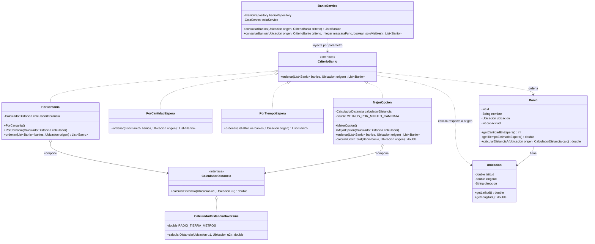

# Diagrama de Clases UML — Patrón Strategy (Búsqueda y Cálculo de Distancia)

Este diagrama modela el desacoplamiento de los algoritmos de ordenamiento y selección de baños respecto de los servicios y del modelo de dominio, permitiendo incorporar nuevos criterios sin modificar la lógica existente (Principio Open/Closed).

## Diagrama Mermaid

## Puntos Clave

1. **Inyección de Dependencia**: `BanioService` no instancia estrategias; recibe la abstracción `CriterioBanio` dinámicamente en tiempo de ejecución.
2. **Estrategias Anidadas**: Las estrategias que calculan proximidad (`PorCercania` y `MejorOpcion`) no se acoplan a la fórmula trigonométrica de la Tierra; delegan en `CalculadorDistancia`, permitiendo sustituir `CalculadorDistanciaHaversine` por cualquier otro algoritmo de cálculo métrico sin impacto.
3. **Cohesión**: `MejorOpcion` pondera la combinación de tiempo de espera en cola y tiempo de caminata a velocidad estándar sin contaminar a la entidad `Banio`.
